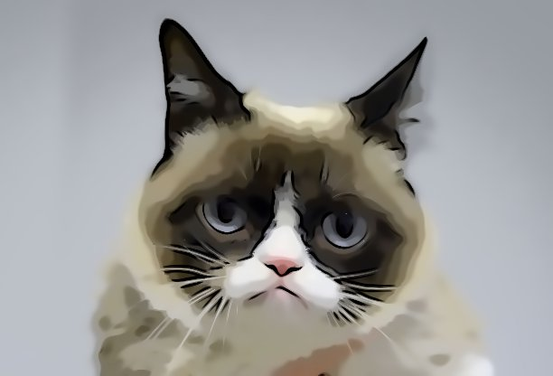
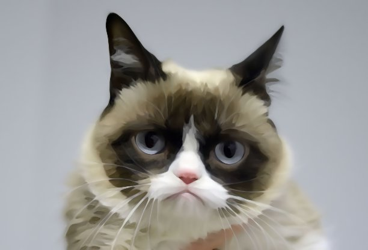
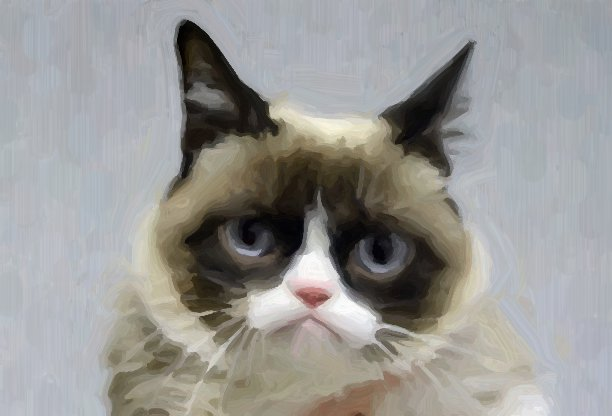
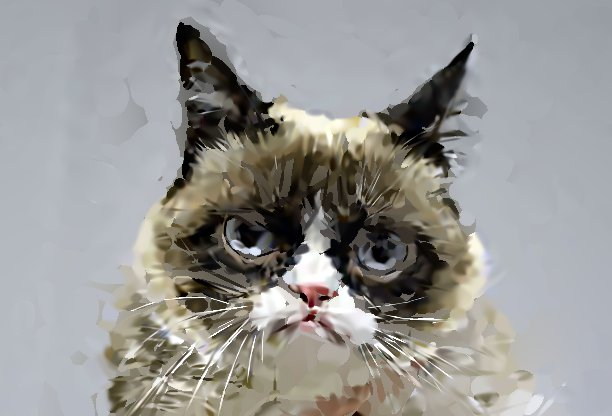

# Brushwork

Painterly image filters (cartoon, oil paint, brush strokes, and fitted Gaussian splats) as WGSL compute shaders on [wgpu], running natively and in the browser.

In 2023 I wrote [opencv-cartoon-effect], a faux cartoon filter that swapped the median blur of the usual tutorials for anisotropic diffusion and mean-shift filtering. It beat the blog posts, but it was still barebones. And also three years ago. This is the second attempt, with a bigger scope: modern Rust, everything on the GPU, one core library behind a CLI and a web UI, and, since I was at it anyway, a look at actual brush strokes and splats rather than only filters. Still purely off a single image; nothing 3D here.

| Input                       | Cartoon                    | Oil paint                   |
|-----------------------------|----------------------------|-----------------------------|
|   |     |     |
| **Brush strokes**           | **Gaussian splats**        | **Splats as strokes**       |
|        |       |  |

All of these are the default settings except the last one, which uses 4000 splats. On the Iris Xe in my laptop, the filters take 30 to 90 ms for the 612×416 sample; fitting the splats takes 1 to 3 s.

## The styles

Everything works in [Oklab] rather than RGB or CIELAB, which makes "how different are these two colors" a plain Euclidean distance. Most styles also share a tangent flow field taken from the smoothed structure tensor of the image, i.e. the local direction of edges, so that smoothing, lines and strokes follow the picture rather than the pixel grid.

- **Cartoon** (`cartoon`) is the successor of the OpenCV version: an edge-preserving bilateral filter applied along and across that flow (Winnemöller, Olsen and Gooch, *Real-Time Video Abstraction*, 2006), lightness quantized into a few levels with soft tanh steps instead of hard posterization, and ink lines from a flow-based difference of Gaussians (Kang, Lee and Chui, *Coherent Line Drawing*, 2007) with the soft XDoG threshold (Winnemöller, 2011). The lines come out thick and thin like a pen would draw them, instead of the uniform crust that adaptive thresholding plus dilation gave me last time.
- **Oil paint** (`kuwahara`) is the anisotropic Kuwahara filter by Kyprianidis, Kang and Döllner (2009), with the polynomial sector weights from its 2010 follow-up by Kyprianidis, Semmo, Kang and Döllner. Each pixel looks at eight sectors of an ellipse stretched along the edge, and takes mostly the mean of the sectors with the least variance, so areas flatten into daubs while edges stay crisp.
- **Brush strokes** (`paint`) follows Aaron Hertzmann's *Painterly Rendering with Curved Brush Strokes of Multiple Sizes* (1998): paint the image coarse to fine, and on every finer layer, only place strokes where the canvas still differs enough from a blurred reference. On the GPU, one compute invocation per grid cell finds the worst spot in its cell and traces a curved stroke along the flow field; the strokes are then drawn as instanced triangle strips with round caps and a procedural bristle and dry-brush texture. Hertzmann paints in random order, which a GPU doesn't do on its own, so the draw order comes from a seeded permutation of the stroke indices (the same seed gives the same painting).
- **Gaussian splats** (`splat`) fits a few thousand anisotropic 2D Gaussians to the image with Adam, in the spirit of Image-GS by Zhang et al. The picture is the normalized weighted sum of all splats, which doesn't depend on their order; that keeps the gradients simple enough to compute per splat over its own bounding box, without the float atomics WGSL doesn't have. Few splats, or a render scale below 1, turn the photo into soft shapes and shards. The fitted splats can also be drawn as brush strokes along their major axes, using the renderer of the brush stroke style.

The splats had one surprise in store: pixels that no splat reaches within three standard deviations come out black, and since no splat covers them, none of them receives a gradient that would ever close the gap. A faint, heavily blurred copy of the image now sits behind the sum and fills those gaps with soft color, and splats that contribute less than about a pixel's worth get respawned where the error is largest.

## Layout

- `crates/fx`: the effects library: wgpu, WGSL, no I/O and no windowing. Each effect lists its parameters (range, step, and default) once, and every frontend builds its controls from that list.
- `crates/fx-cli`: the `fx` binary for images in and out.
- `crates/fx-wasm`: [wasm-bindgen] API for the browser (`Renderer.create(canvas)`, `setImage`, `render`), built with [wasm-pack].
- `crates/fx-playground`: a bare [Trunk] page for poking at shaders, configured through the query string, e.g. `?effect=cartoon&levels=4`.
- `web/`: the SvelteKit UI with drag and drop, sliders, hold-to-compare, and PNG download. Yarn comes through Corepack.

## Running

The tasks are defined for [Task]:

```sh
task test      # GPU tests; set WGPU_FORCE_FALLBACK_ADAPTER=1 to use a software adapter
task samples   # every effect on the sample image, into out/
task trunk     # dev page on http://127.0.0.1:8180
task web       # builds the wasm package, then starts the Vite dev server
```

The CLI takes an effect, an image, and any number of parameter overrides:

```sh
cargo run --release -p fx-cli -- paint assets/grumpy-cat.jpg -o out/paint.png -s brush=24 -s layers=4
cargo run --release -p fx-cli -- --list   # all effects and parameters as JSON
```

The browser builds need WebGPU, since everything runs as compute shaders and there is no WebGL fallback. CI runs the tests on Mesa's software Vulkan driver (lavapipe), so they don't need a GPU either.

## Caveat emptor

- A splat fit is submitted to the GPU as a single batch of work. That is fine at the default settings, but large splat counts with many iterations may run into a browser's GPU watchdog.
- Each 16×16 tile holds at most 512 splats for the forward pass; very dense regions could drop some.
- Splats drawn as strokes are straight lines, and the thin, elongated splats along edges (whiskers, mostly) turn into rather spiky strokes.

## License

[EUPL-1.2](LICENSE.md)

[wgpu]: https://wgpu.rs
[opencv-cartoon-effect]: https://github.com/sunsided/opencv-cartoon-effect
[Oklab]: https://bottosson.github.io/posts/oklab/
[wasm-bindgen]: https://github.com/rustwasm/wasm-bindgen
[wasm-pack]: https://github.com/rustwasm/wasm-pack
[Trunk]: https://trunkrs.dev
[Task]: https://taskfile.dev
